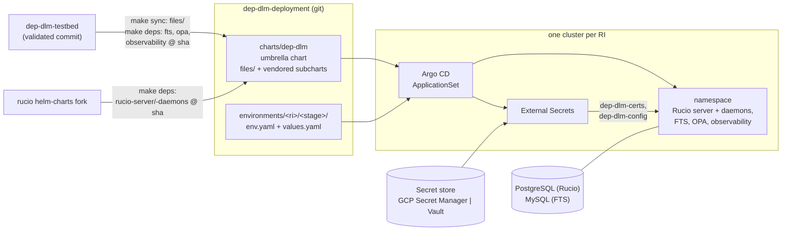
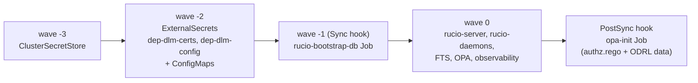
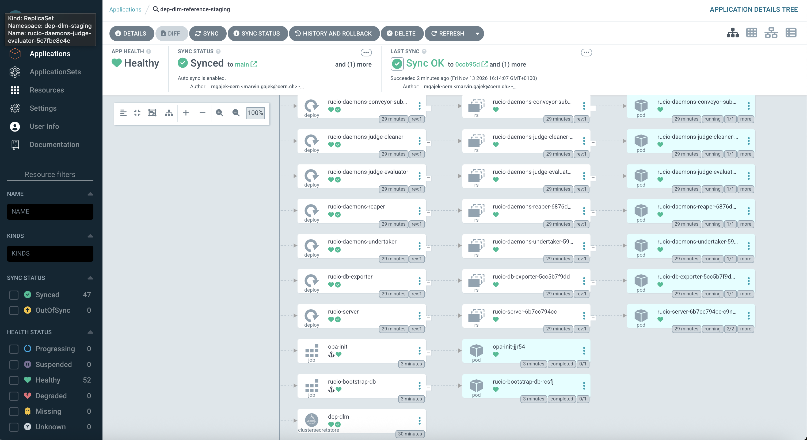
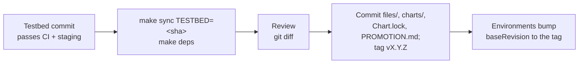

# dep-dlm-deployment

GitOps deployment of the DEP DLM data orchestration layer (Rucio server and
daemons, FTS, OPA) for RI-SCALE partners. Each RI runs its own instance, with
its own cluster, secrets store and upgrade pace. Patterns are validated in
[dep-dlm-testbed](https://github.com/RI-SCALE/dep-dlm-testbed) first and then
promoted here (see `PROMOTION.md`).



## Layout

| Path | What |
|---|---|
| `charts/dep-dlm/` | Thin umbrella over the testbed's charts (`git+https`, pinned to commits, vendored as `.tgz` in `charts/`) plus secrets, ConfigMaps, DB bootstrap, optional Gateway |
| `charts/dep-dlm/files/` | Patches, scripts and OPA policies copied from the testbed by `make sync`, in the testbed's layout |
| `environments/<ri>/<stage>/` | `env.yaml` (namespace, pinned `baseRevision`, ESO) and `values.yaml` (overrides only) |
| `argocd/root.yaml.tmpl` | External Secrets plus an ApplicationSet for one environment |
| `scripts/` | `bootstrap.sh`, `sync-from-testbed.sh` |
| `.devcontainer/` | kubectl, Helm with helm-git, yq, gcloud |

`<ri>` is `eiscat`, `enes`, `euro-bioimaging`, `bbmri` or `reference`;
`<stage>` is `staging` or `production`. Environments are added when there is
something real to deploy. `reference/staging` runs on the testbed's GCP
infrastructure.

## Secrets stores

| `secretStore.provider` | Use |
|---|---|
| `gcpsm` | GCP Secret Manager, Workload Identity (public cloud) |
| `vault` | Vault, Kubernetes auth (on premise) |

## Order of a sync



| Wave | Resources |
|---|---|
| -3 | `ClusterSecretStore` |
| -2 | ExternalSecrets `dep-dlm-certs`, `dep-dlm-config`; ConfigMaps |
| -1 | `rucio-bootstrap-db` Job (Sync hook) |
| 0 | rucio-server, rucio-daemons, FTS, OPA, observability |
| PostSync | `opa-init` Job (pushes authz.rego and ODRL data) |

## Getting started

```bash
git clone https://github.com/RI-SCALE/dep-dlm-deployment.git
make lint                                                    # renders every environment from the vendored subcharts
make bootstrap ENV=reference/staging ARGS=--install-argocd   # from that cluster's kubectl context
```

On GKE, get that context with
`gcloud container clusters get-credentials <cluster> --zone <zone> --project <project>`.

## First sync

The dep-dlm Application might fail its first attempts until External Secrets
(CRDs and webhook) is up, typically with `no endpoints available for service
"<eso>-webhook"`. This is expected: the sync retries with backoff (30 s up to
5 min) and converges in a few minutes. Watch it with:

```bash
kubectl -n argocd get applications -w
kubectl -n <namespace> get externalsecret,jobs,pods,gateway,httproute
# e.g.
kubectl -n dep-dlm-staging get externalsecret,jobs,pods,gateway,httproute
```

If ESO is Healthy but the Application is still waiting in backoff, force a
refresh instead of waiting:

```bash
kubectl -n argocd annotate application dep-dlm-<ri>-<stage> \
  argocd.argoproj.io/refresh=hard --overwrite
# e.g.
kubectl -n argocd annotate application dep-dlm-reference-staging argocd.argoproj.io/refresh=hard --overwrite
```

`kubectl -n argocd get application dep-dlm-<ri>-<stage> -o yaml` shows the
last sync result under `status.operationState` if it does not converge.

## Argo CD UI

```bash
make argocd-open   # port-forwards argocd-server to https://localhost:8080 until Ctrl-C
```

It prints the initial `admin` password (from `argocd-initial-admin-secret`).
The certificate is self-signed, so accept the browser warning. In the
devcontainer, VS Code forwards port 8080 to the host.



## Promoting a testbed commit

A promotion copies the deployed files from a validated testbed commit and
pins the testbed subcharts to the same commit, so they cannot drift apart.



```bash
make sync TESTBED=<validated sha> [RUCIO_REF=<ref>]   # files/ + chart refs in Chart.yaml
make deps && make lint                                 # re-vendor the subcharts (needs helm-git)
git diff                                               # what is being promoted
git add charts/dep-dlm PROMOTION.md && git commit
```

`TESTBED` also takes a tag, a branch or a path to a local checkout; refs are
always pinned as full commit SHAs. Only `make deps` needs helm-git: Argo CD
renders the committed `.tgz` subcharts, so it needs neither the plugin nor
access to the source repos. Run `make deps` only when the refs change, since
Helm rewrites the archives with new timestamps.

## Adding an environment

1. Copy `environments/reference/staging/` to `environments/<ri>/<stage>/`.
2. Set namespace, ESO, secrets store, remote secret keys, DB host and, on GKE,
   the Gateway.
3. Seed the store with the keys listed in `PROMOTION.md`.
4. `make bootstrap ENV=<ri>/<stage> ARGS=--install-argocd` on that cluster.
