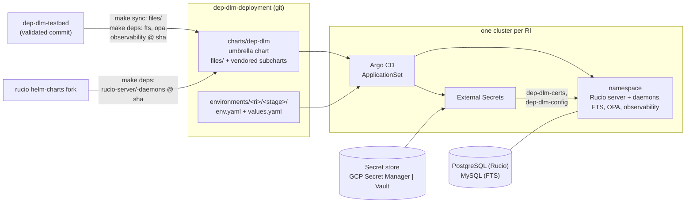
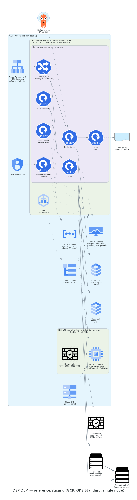
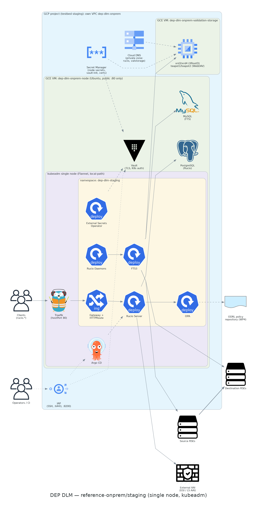
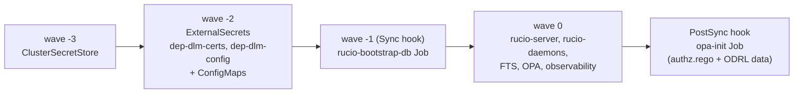
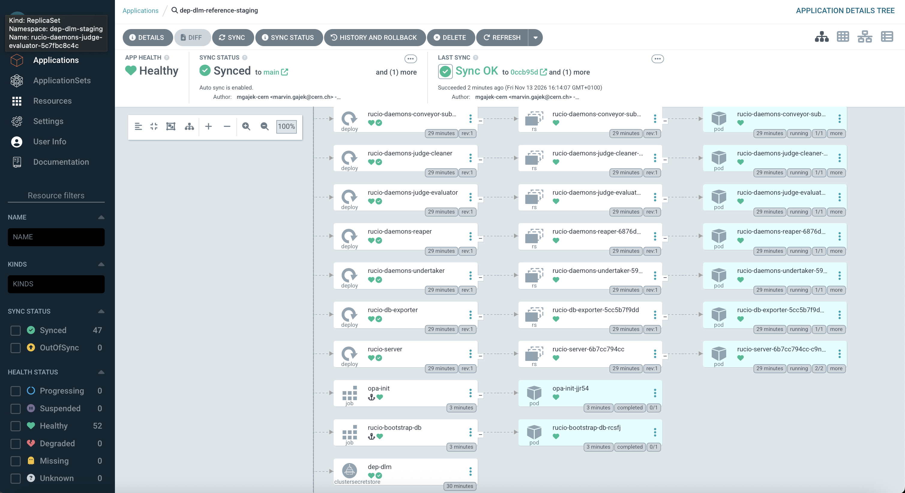
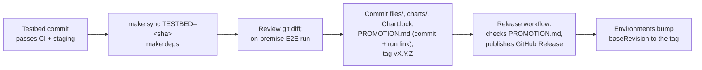

# dep-dlm-deployment

GitOps deployment of the DEP DLM data orchestration layer (Rucio server and
daemons, FTS, OPA) for RI-SCALE partners. Each RI runs its own instance, with
its own cluster, secrets store and upgrade pace.

Developed within RI-SCALE WP2 (DEP data lifecycle management).

Patterns are validated in
[dep-dlm-testbed](https://github.com/RI-SCALE/dep-dlm-testbed) first and then
promoted here (see `PROMOTION.md`).



## Layout

| Path | What |
|---|---|
| `charts/dep-dlm/` | Thin umbrella over the testbed's charts (`git+https`, pinned to commits, vendored as `.tgz` in `charts/`) plus secrets, ConfigMaps, DB bootstrap, optional Gateway |
| `charts/dep-dlm/files/` | Patches, scripts and OPA policies copied from the testbed by `make sync`, in the testbed's layout |
| `environments/<ri>/<stage>/` | `env.yaml` (namespace, pinned `baseRevision`, ESO) and `values.yaml` (overrides only) |
| `argocd/` | `root.yaml.tmpl` (External Secrets + ApplicationSet per environment), `traefik.yaml.tmpl` (on premise) |
| `terraform/`, `terraform.mk` | On-premise reference: GCE VM with kubeadm, host databases and Vault |
| `.github/workflows/` | On-premise reference E2E (terraform, gitops, e2e, destroy); static checks; release on `v*` tags |
| `scripts/` | `bootstrap.sh`, `sync-from-testbed.sh` |
| `docs/` | [Single-node install, configuration, upgrades](docs/single-node.md); deployment diagrams (`make diagrams`) |
| `.devcontainer/` | kubectl, Helm with helm-git, yq, gcloud, Terraform, graphviz |

`<ri>` is `eiscat`, `enes`, `euro-bioimaging`, `bbmri`, `reference` or
`reference-onprem`; `<stage>` is `staging` or `production`. Environments are
added when there is something real to deploy. `reference/staging` runs on the
testbed's GCP infrastructure, `reference-onprem/staging` on one GCE VM.

## Secrets stores

| `secretStore.provider` | Use |
|---|---|
| `gcpsm` | GCP Secret Manager, Workload Identity (public cloud) |
| `vault` | Vault, Kubernetes auth (on premise) |

## Reference deployments

The two validated setups (click for full size). Regenerate them with `make diagrams`.

<table>
<tr>
<th>reference/staging: GKE, <code>gcpsm</code></th>
<th>reference-onprem/staging: kubeadm VM, <code>vault</code></th>
</tr>
<tr>
<td valign="top"><a href="docs/diagrams/generated/reference_staging_gcp.png"></a></td>
<td valign="top"><a href="docs/diagrams/generated/reference_onprem_staging.png"></a></td>
</tr>
</table>

## Requirements

- A Kubernetes cluster (Argo CD is installed by `make bootstrap ... ARGS=--install-argocd`,
  External Secrets by the root Application); for routing, a Gateway API implementation.
- A secrets store, GCP Secret Manager or Vault (see [Secrets stores](#secrets-stores)),
  seeded with:
  - `dep-dlm-config` keys: `server.cfg`, `alembic.ini`, `idpsecrets.json`,
    `fts3config`, `fts3restconfig`, `docker-entrypoint.sh`; with observability,
    `rucio-db-dsn`, `fts-db-dsn`.
  - `dep-dlm-certs` keys: `hostcert.pem`, `hostkey.pem`, `hostcert_with_key.pem`,
    `rucio_ca.pem`, `tls_ca_bundle.pem`, `5fca1cb1.0`, `5fca1cb1.signing_policy`.
- External PostgreSQL (Rucio) and MySQL (FTS); an OIDC IdP profile as in the
  [testbed's runbook 05](https://github.com/RI-SCALE/dep-dlm-testbed/blob/main/docs/runbooks/05-adding-a-new-idp-profile.md).

For one machine (kubeadm with PostgreSQL, MySQL and Vault on the host), see [docs/single-node.md](docs/single-node.md); it also explains each key.

## Known limitations

- Upstream Rucio and FTS are patched (testbed `patches/`); see the testbed's
  `docs/patches.md`.
- The Gateway is HTTP only (GKE Gateway; Traefik on premise); public TLS follows
  the testbed's runbook 08.
- Only Rucio is routed through the Gateway; FTS is reached in-cluster.
- OPA's policy is loaded by the `opa-init` PostSync hook: after an OPA restart
  without a sync, Rucio denies requests until the next sync or `make opa-ingest ENV=<ri>/<stage>`.

## Order of a sync



| Wave | Resources |
|---|---|
| -3 | `ClusterSecretStore` |
| -2 | ExternalSecrets `dep-dlm-certs`, `dep-dlm-config`; ConfigMaps |
| -1 | `rucio-bootstrap-db` Job (Sync hook) |
| 0 | rucio-server, rucio-daemons, FTS, OPA, observability |
| PostSync | `opa-init` Job (pushes authz.rego and ODRL data) |

## Getting started

```bash
git clone https://github.com/RI-SCALE/dep-dlm-deployment.git
make lint                                                    # renders every environment from the vendored subcharts
make bootstrap ENV=reference/staging ARGS=--install-argocd   # from that cluster's kubectl context
```

On GKE, get that context with
`gcloud container clusters get-credentials <cluster> --zone <zone> --project <project>`.

## First sync

The dep-dlm Application might fail its first attempts until External Secrets
(CRDs and webhook) is up, typically with `no endpoints available for service
"<eso>-webhook"`. This is expected: the sync retries with backoff (30 s up to
5 min) and converges in a few minutes. Watch it with:

```bash
kubectl -n argocd get applications -w
kubectl -n <namespace> get externalsecret,jobs,pods,gateway,httproute
# e.g.
kubectl -n dep-dlm-staging get externalsecret,jobs,pods,gateway,httproute
```

If ESO is Healthy but the Application is still waiting in backoff, force a
refresh instead of waiting:

```bash
kubectl -n argocd annotate application dep-dlm-<ri>-<stage> \
  argocd.argoproj.io/refresh=hard --overwrite
# e.g.
kubectl -n argocd annotate application dep-dlm-reference-staging argocd.argoproj.io/refresh=hard --overwrite
```

`kubectl -n argocd get application dep-dlm-<ri>-<stage> -o yaml` shows the
last sync result under `status.operationState` if it does not converge.

## Argo CD UI

```bash
make argocd-open   # port-forwards argocd-server to https://localhost:8080 until Ctrl-C
```

It prints the initial `admin` password (from `argocd-initial-admin-secret`).
The certificate is self-signed, so accept the browser warning. In the
devcontainer, VS Code forwards port 8080 to the host.



## Promoting a testbed commit

A promotion copies the deployed files from a validated testbed commit and
pins the testbed subcharts to the same commit, so they cannot drift apart.



```bash
make sync TESTBED=<validated sha> [RUCIO_REF=<ref>]   # files/ + chart refs in Chart.yaml
make deps && make lint                                 # re-vendor the subcharts (needs helm-git)
git diff                                               # what is being promoted
# run the on-premise E2E workflow on the branch; in PROMOTION.md add the run links,
# rename "## Unreleased" to "## vX.Y.Z" and add a new empty "## Unreleased" above it
git add charts/dep-dlm PROMOTION.md && git commit && git push
git tag -a vX.Y.Z -m "dep-dlm vX.Y.Z" && git push origin vX.Y.Z   # Release workflow checks and publishes
```

Rolling back is the reverse: set `baseRevision` back to the previous tag and restore the databases if the release migrated a schema
([docs/single-node.md](docs/single-node.md#3-upgrades-patching-and-rollback)).

`TESTBED` also takes a tag, a branch or a path to a local checkout; refs are
always pinned as full commit SHAs. Only `make deps` needs helm-git: Argo CD
renders the committed `.tgz` subcharts, so it needs neither the plugin nor
access to the source repos. Run `make deps` only when the refs change, since
Helm rewrites the archives with new timestamps.

## Adding an environment

0. On premise, prepare the machine first: [docs/single-node.md](docs/single-node.md).
1. Copy `environments/reference/staging/` (cloud, Secret Manager) or
   `environments/reference-onprem/staging/` (on premise, Vault) to
   `environments/<ri>/<stage>/`.
2. Set namespace, ESO, secrets store, remote secret keys, DB host and, on GKE,
   the Gateway.
3. Seed the store with the keys listed under [Requirements](#requirements).
4. `make bootstrap ENV=<ri>/<stage> ARGS=--install-argocd` on that cluster.
