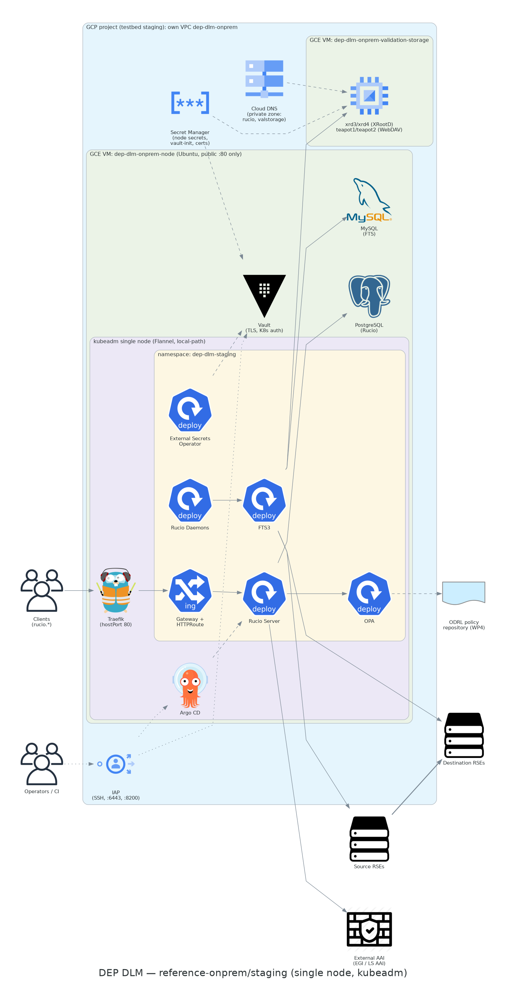

# Single-node installation, configuration and upgrades

How to run DEP DLM on one machine the way `reference-onprem/staging` does it:
kubeadm for Rucio, FTS and OPA; PostgreSQL, MySQL and Vault on the host,
outside Kubernetes. On GCP, [terraform/modules/onprem-node](../terraform/modules/onprem-node/) does all of this
in its startup script ([templates/startup-script.sh.tftpl](../terraform/modules/onprem-node/templates/startup-script.sh.tftpl)); this page is the
same thing for a partner's own machine.

## 1. Install

### Machine

| | Reference | Notes |
|---|---|---|
| OS | Ubuntu 24.04 LTS | any distro with containerd and the pkgs.k8s.io repos |
| Size | 4 vCPU, 16 GB RAM, 100 GB disk (`e2-standard-4`) | Rucio, FTS, OPA, both databases and Vault |
| Inbound, public | TCP 80 (Gateway, Rucio) | 443 once public TLS is added (testbed runbook 08) |
| Inbound, admins only | 22, 6443 (kube-apiserver), 8200 (Vault) | IAP on GCP; VPN or bastion on premise |
| Inbound, pods and node subnet | 5432 (PostgreSQL), 3306 (MySQL), 8200 (Vault) | pods reach them on the node IP |

### Versions

| Component | Version | Set in |
|---|---|---|
| Kubernetes (kubeadm, kubelet, kubectl) | 1.36 (`v1.36.0`) | `onprem-node` `kubernetes_minor`, `kubernetes_version` |
| Flannel | `v0.26.1` | `flannel_version` |
| local-path-provisioner (default StorageClass) | `v0.0.30` | `local_path_version` |
| Gateway API CRDs (standard) | `v1.5.1` | `gateway_api_version` (Traefik v3.7 needs TLSRoute v1) |
| Traefik chart | `42.4.0` | `TRAEFIK_CHART_VERSION` in `scripts/bootstrap.sh` |
| PostgreSQL, MySQL, Vault | distro / HashiCorp apt packages | startup script |

### Steps

Commands are condensed from the startup script; run them as root.

1. **Base packages:** `jq curl gpg ca-certificates apt-transport-https`.
2. **PostgreSQL (Rucio):** `listen_addresses = '*'`; in `pg_hba.conf` allow
   `rucio`/`rucio` with `scram-sha-256` from the pod CIDR (`10.244.0.0/16`)
   and the node subnet; create role `rucio` (login, password) and database
   `rucio` owned by it.
3. **MySQL (FTS):** `bind-address = 0.0.0.0` and
   `log_bin_trust_function_creators = 1` (FTS schema upgrades create
   triggers); create database `fts` and user `'fts'@'%'` with all privileges
   on `fts.*`.
4. **Vault:** HashiCorp apt repo, `/etc/vault.d/vault.hcl` with file storage
   in `/opt/vault/data` and a TLS listener on `0.0.0.0:8200`. The certificate
   is issued by the same CA as the Rucio certificates, so the
   `ClusterSecretStore`'s `caBundle` is `rucio_ca.pem`. Then
   `vault operator init` and `vault operator unseal` (the reference keeps
   one key in Secret Manager to unseal itself on boot, which is not for
   production).
5. **Kernel and runtime:** swap off; modules `overlay`, `br_netfilter`;
   sysctls `net.bridge.bridge-nf-call-ip{,6}tables = 1`,
   `net.ipv4.ip_forward = 1`; containerd with `SystemdCgroup = true`.
6. **Kubernetes:** kubelet, kubeadm and kubectl from
   `pkgs.k8s.io/core:/stable:/v1.36`, then `apt-mark hold`. `kubeadm init`
   with `templates/kubeadm-config.yaml.tftpl`: node IP as advertise address,
   no control-plane taint (single node), pod subnet `10.244.0.0/16`, service
   subnet `10.96.0.0/12`, `cgroupDriver: systemd`, API SANs for every name
   admins use.
7. **Cluster add-ons:** Flannel, local-path-provisioner as the default
   StorageClass, Gateway API CRDs
   (`kubectl apply --server-side -f .../standard-install.yaml`).
8. **Vault contents:** `terraform/environments/onprem/vault` (module
   `vault-config`) writes the KV v2 entries `dep-dlm-onprem/config` and
   `dep-dlm-onprem/certs` and the Kubernetes auth role `dep-dlm` for the ESO
   service account (`external-secrets/external-secrets`, bound to
   `system:auth-delegator` by the chart). Without Terraform, write the same
   keys (section 2) with `vault kv put`.
9. **GitOps:** `make bootstrap ENV=<ri>/<stage> ARGS=--install-argocd`.
   With `gateway.controller: traefik` in `env.yaml`, bootstrap also applies
   `argocd/traefik.yaml.tmpl`: a DaemonSet on hostPort 80, no Service,
   GatewayClass `traefik`. The chart's Gateway listens on 8000 (Traefik's
   `web` entryPoint).

On GCP: `make tf-apply TF_ENV=onprem/infra`, `make onprem-vault-init`,
`make onprem-vault-apply`, `make onprem-smoke-test`, then bootstrap
(see `terraform/README.md`), or the *On-premise reference* workflow.

### Environment values that are site-specific

In `environments/<ri>/<stage>/values.yaml`: `secretStore.vault.server`
(`https://<node IP>:8200`), `caBundle` (base64 of the CA), the KV keys
`secrets.certsKey` and `secrets.configKey`, `bootstrapDb.dbHost`, and the
Gateway `routes[].hostname`.

## 2. Configuration

`dep-dlm-config` and `dep-dlm-certs` are created by External Secrets from
the store. On Vault they come from [terraform/modules/vault-config](../terraform/modules/vault-config), whose
[templates/](../terraform/modules/vault-config/templates/) are copied from the testbed's
`deploy/terraform/modules/secrets/templates/` by `make sync`, so both stores
render the same files.

### `dep-dlm-config`

| Key | Used by (mounted at) | What to set |
|---|---|---|
| `server.cfg` | Rucio server (`/opt/rucio/etc/rucio.cfg`), daemons (`conf.d/00_server.cfg`) | `[database] default` (PostgreSQL DSN); `[policy] package = rucio_opa_v1_policy` (OPA); `[oidc] issuer`, `expected_audience`, `expected_scope`, `token_strategy` (`exchange` for managed tokens, `client_credentials` for unmanaged); `[conveyor] transfertool = fts3`, `cacert`, `usercert`, `allow_user_oidc_tokens`; `[bootstrap]` root userpass identity; `[common] loglevel` (DEBUG in the reference) |
| `alembic.ini` | Rucio server and daemons (`/opt/rucio/etc/alembic.ini`) | `sqlalchemy.url` (same DSN); `script_location` follows the image's Python path |
| `idpsecrets.json` | Rucio server and daemons (`/opt/rucio/etc/idpsecrets.json`) | Keyed by issuer: `client_id`, `client_secret`, `redirect_uris` on the public Rucio host, `audience: rucio`, `scope` and `capabilities` from the IdP profile (`profiles/rucio/<profile>/`) |
| `fts3config` | FTS server (`/etc/fts3/fts3config`) | `SiteName`, `DbType=mysql`, `DbUserName`, `DbPassword`, `DbConnectString=<host>/fts`; `OidcResourceIndicatorProfile` from `profiles/fts/<profile>/`; `[roles]`; `LogLevel` |
| `fts3restconfig` | FTS REST | Database as above; `OAuth2=True`, `AllowedOAuth2IssuerURLs=<issuer>`, `AuthorizedAudiences=fts,rucio`, `VerifyAudience=False`; `AllowNonManagedTokens=True` only for `TOKEN_MODE=unmanaged` |
| `docker-entrypoint.sh` | FTS container (`/docker-entrypoint.sh`) | Waits for MySQL, runs `fts-database-upgrade.py` (errors ignored), refreshes the CA bundle, starts the FTS daemons and httpd |
| `rucio-db-dsn`, `fts-db-dsn` | sql_exporter, only with observability | DSNs with URL-encoded passwords |
| `oidc-client.cfg`, `userpass-client.cfg`, `valstorage-ip` | not mounted by the chart; client configs for tests and operators | Rucio host, auth type, account |

Token mode: `egi-dev` needs `unmanaged` (EGI dev rejects custom audiences);
`ls-aai-dev` works with both.

### `dep-dlm-certs`

| Key | What |
|---|---|
| `hostcert.pem`, `hostkey.pem` | Server certificate and key (Rucio, FTS) |
| `hostcert_with_key.pem` | Both in one file: the conveyor's `usercert` towards FTS |
| `rucio_ca.pem`, `tls_ca_bundle.pem` | CA trusted by Rucio, FTS and the storages; system-wide bundle |
| `5fca1cb1.0`, `5fca1cb1.signing_policy` | The CA under its OpenSSL hash name for `/etc/grid-security/certificates` (fixed names, see backlog) |

Every storage endpoint the transfers use must present a certificate with
its hostname in the SAN (for example `VALSTORAGE_EXTERNAL_SAN`), or FTS fails
with "certificate issued for a different hostname".

## 3. Upgrades, patching and rollback

Single node means no drain: plan a maintenance window for anything that
restarts the node or the control plane. **Before any of them, back up both
databases** (`pg_dump rucio`, `mysqldump fts`) and Vault (stop it and copy
`/opt/vault/data`). Rucio (alembic) and FTS (`fts-database-upgrade.py`)
schema migrations only go forward, so rolling back across one means
restoring the backup.

| Change | Upgrade | Rollback |
|---|---|---|
| DEP DLM release | Set `baseRevision` in `env.yaml` to the new tag (README, *Promoting a testbed commit*); Argo CD syncs | Set `baseRevision` back to the previous tag; restore the databases if the release migrated a schema |
| Config or certificates | Update the store (`make onprem-vault-apply`, or `vault kv put`). ESO refreshes the Secret, but subPath mounts don't update, so restart: `kubectl -n <ns> rollout restart deploy` | `vault kv rollback -mount=secret -version=<n> <key>`, then the same restart |
| OPA restart (any of the above) | OPA loses its policy until the `opa-init` PostSync hook runs: sync the Application, or `make opa-ingest ENV=<ri>/<stage>` | n/a |
| Kubernetes minor (one at a time) | `apt-mark unhold kubeadm`, install `1.<n+1>`, `kubeadm upgrade plan`, `kubeadm upgrade apply v1.<n+1>.x`, then kubelet and kubectl, `systemctl restart kubelet`, hold again; keep the devcontainer's kubectl within one minor | Not supported by kubeadm: restore from the etcd snapshot or rebuild the node and bootstrap again (the state lives in git, the databases and Vault) |
| Gateway API or Traefik | Apply the new `standard-install.yaml` server-side; bump `TRAEFIK_CHART_VERSION` and re-run bootstrap. Check Traefik's required Gateway API version first | Re-apply the previous versions |
| OS packages | `apt-get upgrade` (Kubernetes packages are held); reboot if needed | Package downgrade from the apt cache |
| PostgreSQL or MySQL major | `pg_upgradecluster`, or MySQL's in-place upgrade, after the backup | Restore the backup on the old version |
| Vault | Upgrade the package, restart, unseal | Reinstall the previous package; restore `/opt/vault/data` if the storage format changed |

After any reboot: unseal Vault (the reference does it on boot), wait for
the node to be Ready, check that the Application is Synced and Healthy,
restore OPA's policy (row above), then `curl http://<host>/ping`.
